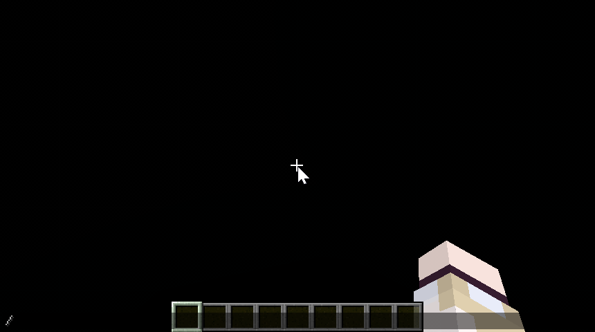
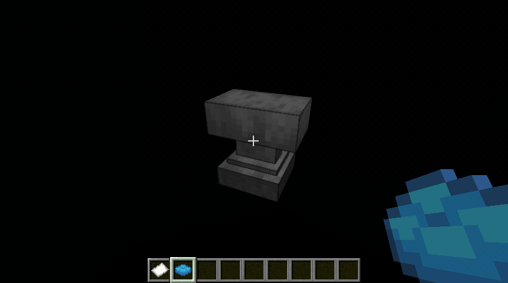
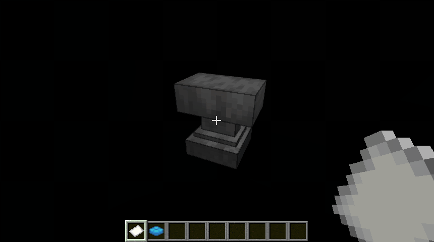
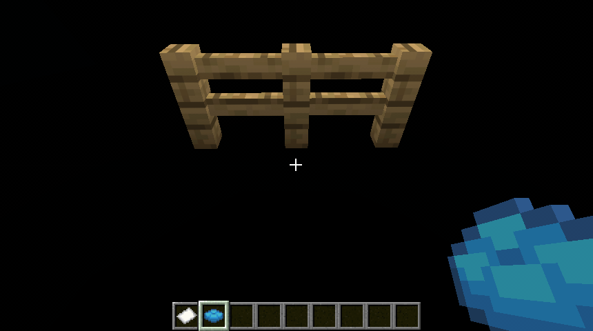

# Precise Cushion Placement 精准坐垫放置

[中文](README.zh-Hans.md) | [**English**](README.md)


## Description

A client-side-only mod that allows players to place cushions at precise Y-coordinates.

By default, it will try to get the Y coordinate offset of the cushion from the held cushion item custom name, offhand item custom name, or the value set by command in order. If a valid value ($\left[0.0,1.0\right]$) is found, a new Y position ($y_{\mathrm{new}}=\left\lfloor y_0\right\rfloor+y_{\mathrm{offset}}$) will be calculated when placing the cushion and a new `BlockHitResult` will be synthesized using the new Y position and `Direction.UP`, thus achieving precise Y coordinate placement.

Y offset sources can be modified through configuration file or command.

> [!WARNING]
>
> Since this method modifies the `BlockHitResult` to deviate from the position pointed by the player's line of sight, it may trigger anti-cheat mechanisms on the server. Please consult the administrator before using such auxiliary mods.

## Configuration

The configuration file is located at `config/precise_cushion_placement.json`.

The default configuration is:

```json
{
  "offsetSources": [
    "CUSHION_ITEM_NAME",
    "OFFHAND_ITEM_NAME",
    "COMMAND"
  ]
}
```

You can also make changes in-game using commands:



## Commands

Subcommands are prefixed with `/precise_cushion_placement`.

| Subcommand                 | Parameters                    | Description                |
|----------------------------|-------------------------------|----------------------------|
| `offset clear`             | None                          | Clear Y offset             |
| `offset get`               | None                          | Get Y offset               |
| `offset set`               | Double, 0.0~1.0               | Set Y offset               |
| `config reload`            | None                          | Reload configuration       |
| `config reset`             | None                          | Reset configuration        |
| `config get`               | None                          | Show current configuration |
| `config set offsetSources` | Enum set, separated by commas | Set Y offset sources       |

## Offset Sources

### `CUSHION_ITEM_NAME`



### `OFFHAND_ITEM_NAME`



### `COMMAND`



## License

MIT License

## Development Notes

This project is based on Fabric-loom and incorporates Forge and NeoForge as dependencies, enabling a single JAR to support multiple loaders.

During development, please ensure that loader-specific content is not introduced into the common codebase. If such content needs to be passed, it must be wrapped in generic interfaces or classes before being passed to the common components.
