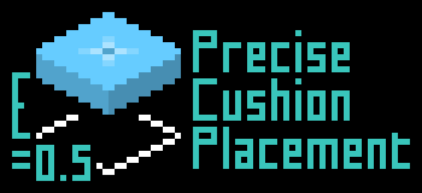

# Precise Cushion Placement 精准坐垫放置

[简介（中文）](#简介) | [Description (English)](#Description)



## 简介

在精准的Y坐标位置放置坐垫。

默认会依次尝试从手持的坐垫物品自定义名称、副手物品自定义名称、命令设置的值获取坐垫的方块内Y坐标偏移量，如果发现有效值（ $\left[0.0,1.0\right]$ ），则会在放置坐垫时计算新的Y坐标（ $y_{\mathrm{new}}=\left\lfloor y_0\right\rfloor+y_{\mathrm{offset}}$ ）并使用新Y坐标和`Direction.UP`合成一个新的`BlockHitResult`，从而实现精准的Y坐标放置。

> [!WARNING]
>
> 由于这种方式修改了`BlockHitResult`使其偏离了玩家视线所指位置，在服务器中可能会触发反作弊机制。使用前请咨询管理员是否允许此类辅助模组。

Y偏移量的来源顺序可以通过配置文件或命令进行修改。枚举值对照表：

- `CUSHION_ITEM_NAME`：坐垫物品自定义名称
- `OFFHAND_ITEM_NAME`：副手物品自定义名称
- `COMMAND`：命令设置的值

命令列表（子命令均以`/precise_cushion_placement`为前缀）：

| 子命令                       | 参数             | 说明        |
|---------------------------|----------------|-----------|
| `offset clear`            | 无              | 清除Y偏移量    |
| `offset get`              | 无              | 获取Y偏移量    |
| `offset set`              | 双精度浮点数，0.0~1.0 | 设置Y偏移量    |
| `config reload`           | 无              | 重新加载配置    |
| `config reset`            | 无              | 重置配置      |
| `config get`              | 无              | 显示当前配置    |
| `config set valueSources` | 枚举值集合，使用逗号分隔   | 设置Y偏移量的来源 |

## Description

Place cushions with precise Y position.

By default, it will try to get the Y coordinate offset of the cushion from the held cushion item custom name, offhand item custom name, or the value set by command in order. If a valid value ($\left[0.0,1.0\right]$) is found, a new Y position ($y_{\mathrm{new}}=\left\lfloor y_0\right\rfloor+y_{\mathrm{offset}}$) will be calculated when placing the cushion and a new `BlockHitResult` will be synthesized using the new Y position and `Direction.UP`, thus achieving precise Y coordinate placement.

> [!WARNING]
>
> Since this method modifies the `BlockHitResult` to deviate from the position pointed by the player's line of sight, it may trigger anti-cheat mechanisms on the server. Please consult the administrator before using such auxiliary mods.

Y offset sources can be modified through configuration file or command. Enum value mapping table:

- `CUSHION_ITEM_NAME`: Cushion item custom name
- `OFFHAND_ITEM_NAME`: Offhand item custom name
- `COMMAND`: Value set by command

Command list (subcommands are prefixed with `/precise_cushion_placement`):

| Subcommand                | Parameters                    | Description                |
|---------------------------|-------------------------------|----------------------------|
| `offset clear`            | None                          | Clear Y offset             |
| `offset get`              | None                          | Get Y offset               |
| `offset set`              | Double, 0.0~1.0               | Set Y offset               |
| `config reload`           | None                          | Reload configuration       |
| `config reset`            | None                          | Reset configuration        |
| `config get`              | None                          | Show current configuration |
| `config set valueSources` | Enum set, separated by commas | Set Y offset sources       |

## Default Configuration 默认配置

```json
{
  "valueSources": [
    "CUSHION_ITEM_NAME",
    "OFFHAND_ITEM_NAME",
    "COMMAND"
  ]
}
```

## License 许可证

MIT License