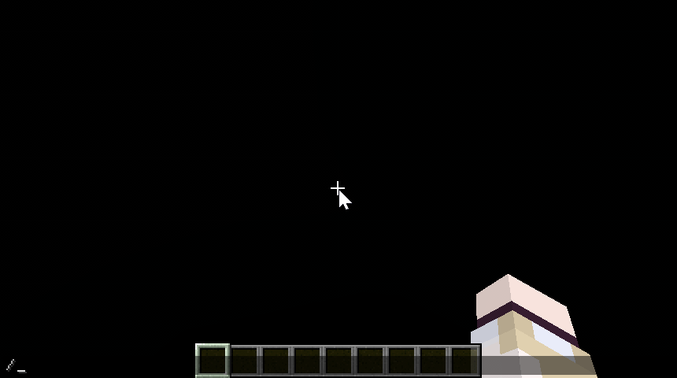

# Precise Cushion Placement 精准坐垫放置

[**中文**](README.zh-Hans.md) | [English](README.md)


## 简介

纯客户端模组，允许玩家在精准的Y坐标位置放置坐垫。

默认会依次尝试从手持的坐垫物品自定义名称、副手物品自定义名称、命令设置的值获取坐垫的方块内Y坐标偏移量，如果发现有效值（ $\left[0.0,1.0\right]$ ），则会在放置坐垫时计算新的Y坐标（ $y_{\mathrm{new}}=\left\lfloor y_0\right\rfloor+y_{\mathrm{offset}}$ ）并使用新Y坐标和`Direction.UP`合成一个新的`BlockHitResult`，从而实现精准的Y坐标放置。

Y偏移量的来源顺序可以通过配置文件或命令进行修改。

> [!WARNING]
>
> 由于这种方式修改了`BlockHitResult`使其偏离玩家视线所指位置，在服务器中可能会触发反作弊机制。使用前请咨询管理员是否允许此类辅助模组。

## 配置

配置文件位于 `config/precise_cushion_placement.json`。

默认配置为：

```json
{
  "offsetSources": [
    "CUSHION_ITEM_NAME",
    "OFFHAND_ITEM_NAME",
    "COMMAND"
  ]
}
```

也可在游戏内通过命令进行修改：



## 命令

子命令均以`/precise_cushion_placement`为前缀。

| 子命令                       | 参数             | 说明        |
|---------------------------|----------------|-----------|
| `offset clear`            | 无              | 清除Y偏移量    |
| `offset get`              | 无              | 获取Y偏移量    |
| `offset set`              | 双精度浮点数，0.0~1.0 | 设置Y偏移量    |
| `config reload`           | 无              | 重新加载配置    |
| `config reset`            | 无              | 重置配置      |
| `config get`              | 无              | 显示当前配置    |
| `config set valueSources` | 枚举值集合，使用逗号分隔   | 设置Y偏移量的来源 |

## 偏移量来源

### `CUSHION_ITEM_NAME`


### `OFFHAND_ITEM_NAME`


### `COMMAND`


## 许可证

MIT License

## 开发说明

本项目以Fabric-loom为基础，将Forge和NeoForge以依赖形式引入，实现单个jar支持多个加载器。

开发时请注意不要在公共部分引入特定于加载器的内容。如需传递此类内容，需要将其包装成通用接口或类来传递到公共部分。
